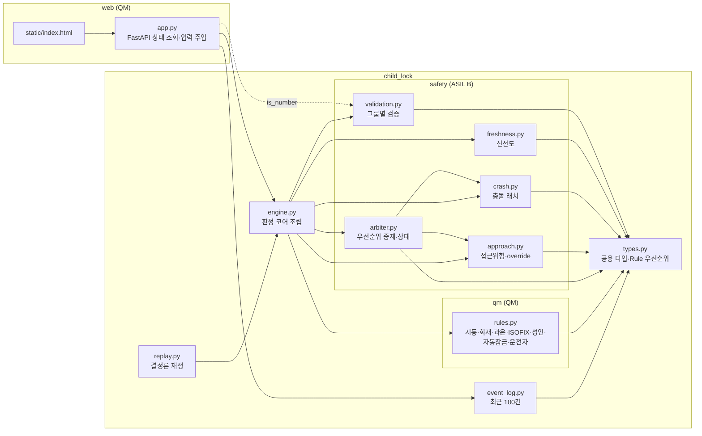
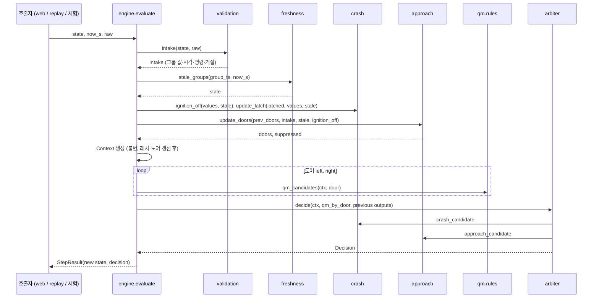
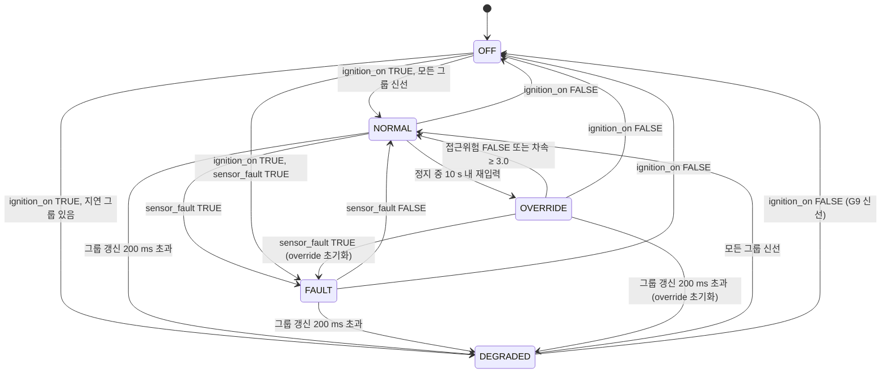

# 전자식 차일드락 제어 SW 아키텍처 설계서

| 항목 | 내용 |
|---|---|
| 문서 ID | SWA-001 |
| 상위 입력 | SWRS-001 (BL-SWR-1.0), PLAN-001 |
| 기준선 | BL-SWA-1.0 |
| A-SPICE | SWE.2 SW 아키텍처 설계 |
| 상태 | 검토 반영본 (REV-G2-001 지적 반영) |

## 1. 설계 원칙

| ID | 원칙 | 근거 |
|---|---|---|
| P-01 | **함수형 판정 코어**: 판정은 `(이전 상태, 평가 시각, 입력) → (다음 상태, 결정)` 순수 함수다. 상태 객체는 불변(frozen dataclass)이다 | SWR-016 결정론, 시험 용이성 |
| P-02 | **시계 주입**: 코어는 실제 시간을 읽지 않는다. 평가 시각은 호출자가 넘긴다 | SWR-016 |
| P-03 | **ASIL B / QM 분리**: ASIL B 요소는 `safety` 패키지, QM 요소는 `qm` 패키지에 두고, `safety`는 `qm`을 import하지 않는다. QM 규칙은 후보만 만들고 최종 결정은 ASIL B 중재기가 한다 | SWR-022, PLAN D-04 |
| P-04 | **단일 우선순위 정의**: 우선순위는 `Rule` 열거형 하나에만 정의한다 | SWR-022, SWRS 3.1 |
| P-05 | **영속 저장 금지**: 이벤트는 메모리에만 둔다 | SWR-012 |

## 2. 정적 구조

### 2.1 컴포넌트

| 컴포넌트 | 분류 | 책임 | 할당 SWR |
|---|---|---|---|
| `types` | ASIL B¹ | 열거형(`Lock`, `State`, `Validity`, `Rule`, `Reason`, `Door`, `Group`), 불변 데이터 구조, 우선순위 순서 | 022 (우선순위 정의) |
| `safety.validation` | ASIL B | 타임스탬프·그룹별·명령 검증, 수락 값 갱신 | 013-1~3 |
| `safety.freshness` | ASIL B | 그룹 신선도 판정 | 013-4·5 |
| `safety.crash` | ASIL B | 충돌 확정·래치·PENDING 판정 | 007, 008 |
| `safety.approach` | ASIL B | 도어별 접근위험 잠금, 억제, t0, override 성립·종료 | 005, 006, 009 |
| `safety.arbiter` | ASIL B | 도어별 최상위 후보 선택, state·priority_reason·reason_code·validity·warning 결정, 센서 고장·입력 지연 규칙 | 021, 022, 013-4 |
| `qm.rules` | QM | QM 규칙 후보 생성 | 001, 002, 003, 004, 017, 018, 020 |
| `engine` | ASIL B¹ | 위 요소를 순서대로 호출하는 판정 코어 | 022, 016 |
| `event_log` | QM | 이벤트 생성(허용 필드만), 최근 100건 링 버퍼 | 010, 011, 012 |
| `replay` | QM | 입력 벡터 재생, 출력 해시 | 016 |
| `web.app` | QM | 상태 조회·이벤트 조회·입력 주입 HTTP API, 직렬화 오류 500 | 014, 015 |
| `web.static` | QM | 시뮬레이터 화면 | 015 |

¹ ASIL B 요소가 의존하므로 ASIL B로 개발한다 (ASIL 상속). `engine`은 QM 요소인 `qm.rules`도 호출하지만, `qm.rules`는 ASIL B로 올리지 않는다. 그 출력이 5장의 간섭 방지 장치(출력 고정표 검사, 조건 재확인, 우선순위)를 거쳐서만 결정에 반영되므로 QM으로 둔다.

### 2.2 의존 규칙

| 허용 | 금지 |
|---|---|
| `safety.*` → `types` | `safety.*` → `qm`, `engine`, `event_log`, `web` |
| `safety.arbiter` → `safety.crash`, `safety.approach` (후보·판정 함수 호출) | 그 밖의 `safety.*` 상호 import |
| `qm.*` → `types` | `qm.*` → `safety`, `engine`, `event_log`, `web` |
| `engine` → `types`, `safety`, `qm` | `engine` → `event_log`, `web` |
| `event_log`, `replay` → `types`, `engine` | `types` → 다른 모든 내부 모듈 |
| `web` → `engine`, `event_log`, `types`, `safety.validation`(`now_s` 검사용 `is_number`) | |

의존 규칙은 단위 시험(`tests/unit/test_architecture.py`)으로 import 문을 검사해 강제한다 (SAP-001).

## 3. 인터페이스

### 3.1 외부 인터페이스 (OEM-IF 대응)

| OEM-IF | 구현 형태 |
|---|---|
| IF-001~003, 007~009 | 원시 스냅샷 `Mapping[str, object]`의 키 (SWRS 4.1 표의 필드명 그대로) |
| IF-004 | 스냅샷의 선택 키 `command: {side, action, source}` |
| IF-005 | `Decision.lock_left`, `Decision.lock_right` |
| IF-006 | `GET /api/status` 응답 JSON (SWR-014 9개 필드) |

### 3.2 내부 인터페이스

| 제공자 | 함수 | 입력 → 출력 |
|---|---|---|
| `engine` | `evaluate(state, now_s, raw)` | `ControllerState, float, Mapping\|None` → `StepResult(state, decision)` |
| `engine` | `initial_state()` | → `ControllerState` |
| `safety.validation` | `intake(state, raw)` | → `Intake` (수락 그룹 값, 갱신 시각, 명령, 거절 여부) |
| `safety.validation` | `is_number(x)` | → `bool` (유한한 실수, 불리언 제외) |
| `safety.freshness` | `stale_groups(group_ts, now_s)` | → `frozenset[Group]` |
| `safety.crash` | `ignition_off(values, stale)` | → `bool` |
| `safety.crash` | `update_latch(latched, values, stale)` | → `bool` |
| `safety.crash` | `crash_candidate(latched)`, `crash_pending(values, stale)` | → `Candidate \| None`, `bool` |
| `safety.approach` | `update_doors(prev_doors, intake, stale, ignition_off)` | → (도어별 `DoorApproach`, 억제 도어 집합) |
| `safety.approach` | `approach_candidate(ctx, door)` | → `Candidate \| None` |
| `qm.rules` | `qm_candidates(ctx, door)` | → `list[Candidate]` |
| `safety.arbiter` | `safety_candidates(ctx, door)` | → `list[Candidate]` |
| `safety.arbiter` | `decide(ctx, qm_by_door, previous)` | → `Decision` |
| `event_log` | `EventLog.append(decision, now_s)`, `EventLog.events()` | → `Event`, `list[Event]` |
| `replay` | `replay(vector)`, `digest(decisions)` | → `list[Decision]`, `str` |

HTTP API (web):

| 메서드·경로 | 요청 | 응답 |
|---|---|---|
| `POST /api/step` | `{"now_s": float, "snapshot": object\|null}` | 상태 JSON (SWR-014) |
| `GET /api/status` | — | 상태 JSON, 평가 전이면 초기 상태 |
| `GET /api/events` | — | 이벤트 배열 (최대 100) |
| `GET /` | — | 시뮬레이터 HTML |

`now_s`를 요청에 넣는 이유: Web 경로도 시계 주입 원칙(P-02)을 따라 같은 입력이면 같은 결과를 내게 한다.

## 4. 동적 동작

### 4.1 평가 주기 시퀀스

### 4.2 SW 상태 전이

`state`는 매 주기 SWRS 3.1 규칙과 2.2 state 우선순위로 다시 계산되는 **파생 값**이다 (저장되는 상태 기계가 아님). 아래는 그 결과 나타나는 전이다.

### 4.3 판정 내부 상태 (ControllerState)

| 항목 | 의미 | 갱신 주체 |
|---|---|---|
| `values` | 그룹별 마지막 수락 값 | validation |
| `group_ts` | 그룹별 갱신 시각 | validation |
| `last_ts` | 마지막 수락 스냅샷 시각 (역행 검사) | validation |
| `crash_latched` | 충돌 래치 | crash |
| `doors` | 도어별 `t0`, `override` (`DoorApproach`) | approach |
| `outputs` | 도어별 직전 출력 | arbiter |

## 5. ASIL 분해와 간섭 방지

- QM 요소(`qm.rules`)는 불변 `Context`만 읽고 `Candidate` 값을 반환한다. 공유 가변 상태가 없으므로 QM 코드가 ASIL B 상태를 직접 바꿀 수 없다.
- 최종 출력은 ASIL B `arbiter`만 만든다. `arbiter`는 QM 후보마다 다음을 검사하고, 하나라도 어긋나면 그 후보를 버린다.
  1. 규칙이 QM 규칙 집합에 속한다.
  2. **출력이 규칙의 고정 출력과 일치한다** (`types.RULE_OUTPUT`: ISOFIX·자동 잠금은 LOCK, 시동 OFF·화재·과온·성인은 RELEASE, 운전자 명령만 둘 다 허용). 예컨대 결함으로 생긴 `(ISOFIX, RELEASE)` 후보는 버려진다.
  3. **ASIL B 규칙보다 우선하는 QM 후보는 조건을 독립 재확인한다**. `IGNITION_OFF`(1), `EMERGENCY_RELEASE`(3), `ISOFIX`(6)는 ASIL B 규칙(센서 고장 유지 5, override 7a, 접근위험 7)을 이길 수 있으므로, `arbiter`가 `Context`의 입력 값과 신선도로 조건을 직접 확인한다.
- 위 검사를 거치면, QM 규칙의 결함이 만들 수 있는 최악의 결과는 "조건이 실제로 참인 QM 규칙이 후보를 내지 않는 것(누락)"뿐이다. 이 경우에도 ASIL B 규칙의 출력은 바뀌지 않는다. 순위가 모든 ASIL B 규칙보다 낮은 QM 후보(성인 해제 8, 자동 잠금 9, 운전자 명령 10)는 우선순위만으로 ASIL B 규칙에 막힌다.
- **한계**: 단일 Python 프로세스에서는 메모리 보호, 실행 시간 보호가 없다. QM 코드의 무한 루프·예외는 ASIL B 코드에 영향을 줄 수 있다. 이 한계는 PC/SIL 범위에서 수용하며, 양산 ECU에서는 MPU·시간 감시로 대체해야 한다 (PLAN D-04).

## 6. 자원·시간

| 항목 | 설계 |
|---|---|
| 평가 주기 | 50 ms, 호출자가 결정 (`ENGINE_PERIOD_S = 0.050`, 설정값) **[가정 A-05]** |
| 판정 계산량 | 규칙 수 고정(12), 도어 2개 → 주기당 상수 시간 |
| 메모리 | 이벤트 100건 상한 (`deque(maxlen=100)`) |
| 동시성 | Web 서버는 단일 컨트롤러 인스턴스를 잠금(`threading.Lock`)으로 보호해 평가를 직렬화 |

## 7. 기술 선택

| 항목 | 선택 | 근거 |
|---|---|---|
| 언어 | Python 3.12 호환 (CI 3.12·3.13) | PLAN D-01 |
| Web | FastAPI + 정적 HTML, 시험은 `fastapi.testclient` | PLAN D-02 |
| 외부 의존 | 코어(`child_lock` 중 `web` 제외)는 표준 라이브러리만 사용 | ASIL B 요소의 외부 의존 최소화 |

## 8. 추적성: SWR → 컴포넌트

| SWR | 컴포넌트 |
|---|---|
| 001, 002, 004 | qm.rules (운전자 명령), safety.arbiter (해제 허용 판단) |
| 003 | qm.rules (자동 잠금) |
| 005, 009 | safety.approach |
| 006 | safety.approach |
| 007, 008 | safety.crash, safety.arbiter |
| 010, 011, 012 | event_log |
| 013 | safety.validation, safety.freshness, safety.arbiter |
| 014, 015 | web.app, web.static |
| 016 | engine, replay |
| 017, 018 | qm.rules, safety.arbiter (조건 재확인) |
| 020 | qm.rules, safety.crash (래치 초기화), safety.approach (override 초기화) |
| 021 | safety.arbiter |
| 022 | types (Rule), safety.arbiter, engine |

모든 SWR(21건)이 하나 이상의 컴포넌트에 할당되었고, 할당되지 않은 컴포넌트는 없다.
